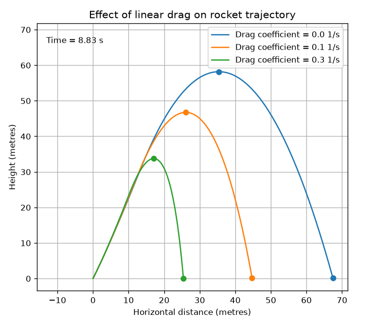
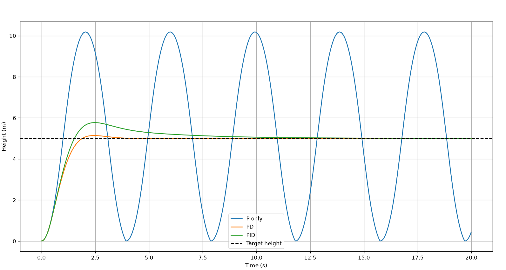
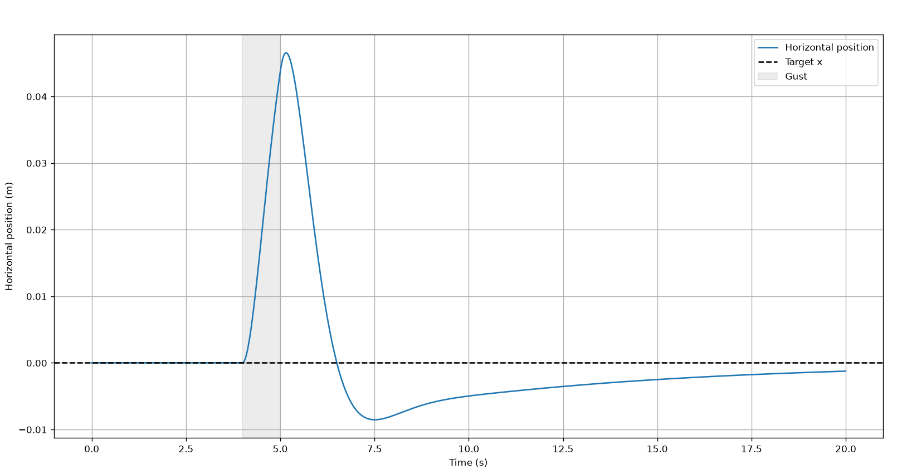

# rocket-flight-and-hover
Python simulations of 2D rocket flight and hover control. I compare flight paths under different drag settings and explore how a simulated rocket holds position during a wind gust.

# Rocket Flight and Hover Simulations

I built these two Python projects as a first-year mechanical engineering student to explore how forces affect rocket flight and how feedback can control motion in order to create a base knowledge for future projects.

## 1. Flight simulation


I started with a vertical flight model and extended it to two dimensions. The model includes gravity, a fixed thrust direction during the burn, decreasing mass as fuel is used, and simplified linear drag.

I ran the same flight with three drag settings and plotted the trajectories in Matplotlib. The plots mark the highest point of each flight, and an animation shows all three runs on the same graph.

## 2. Hover control



I simulated a rocket lifting off from the ground and aiming for a height of 5 m. I compared P, PD, and PID controllers using two measures: how far each run overshot 5 m and how long it took to enter and stay within 5 cm of the target.

With the gains I tested and no vertical disturbance, PD had the smallest overshoot and settled fastest. The velocity term helped brake the climb. In the PID run, the integral term still contributed upward thrust as the rocket first reached 5 m, which increased overshoot.

I then added a separate horizontal controller and a simulated sideways gust to see how the rocket responds when pushed away from its target position.

## Model assumptions

Both simulations treat the rocket as a point mass. The flight model uses a prescribed thrust and fixed thrust direction. The hover model assumes constant mass and independently controlled horizontal and vertical forces.

## How to run

Install Matplotlib, then run either script from the repository folder:

```bash
python -m pip install matplotlib
python 2D_Rocket_Simulation_with_drag.py
python 2D_Rocket_hover_with_gust.py
```
